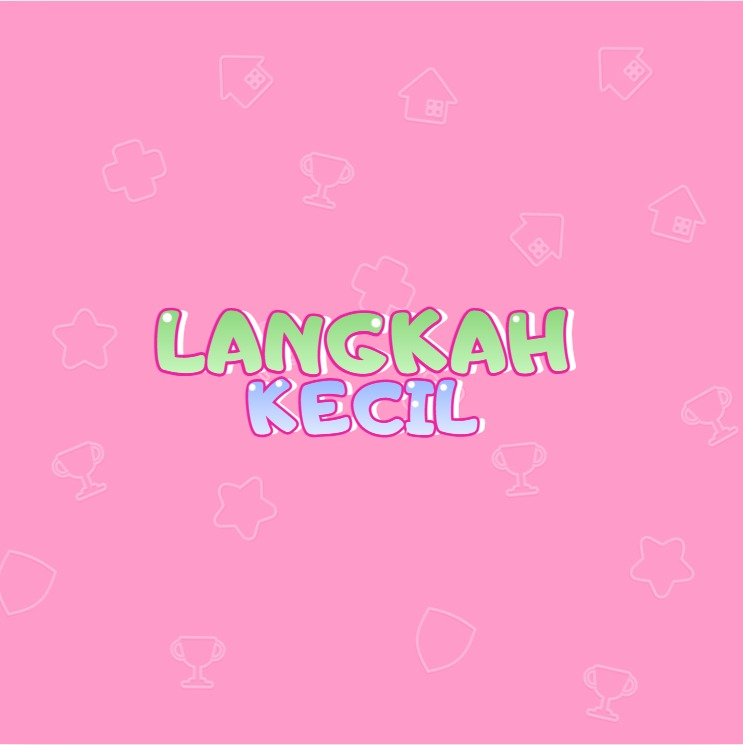

<div align="center">

  

  # 🌱 Langkah Kecil
  ### *Game Edukatif dengan Sentuhan Emosi dan Perhatian untuk Setiap Anak*

  [](https://godotengine.org)
  [](https://github.com/radityobw/langkah-kecil/releases/latest)
  [](https://github.com/radityobw/langkah-kecil/actions/workflows/ci.yml)
  [](https://radityobw.github.io/langkah-kecil/)
  [](https://github.com/radityobw/langkah-kecil/blob/main/LICENSE)

  [**Bahasa Indonesia**](#-bahasa-indonesia) • [**English**](#-english) • [**Unduh APK**](#-unduh--instal-apk-android-7) • [**Pengujian**](#-pengujian--validasi-proyek) • [**GitHub Pages**](https://radityobw.github.io/langkah-kecil/)

</div>

---

# 🇮🇩 Bahasa Indonesia

## 🎮 Tentang Proyek

**Langkah Kecil** adalah aplikasi permainan edukatif inklusif yang dirancang khusus untuk **anak-anak berkebutuhan khusus**, membantu mereka belajar melalui interaksi yang aman, menyenangkan, dan penuh empati. Dikembangkan menggunakan **Godot Engine 4.5** (*mobile renderer*), aplikasi ini memadukan latihan pengenalan emosi interaktif dengan manajemen jadwal harian visual.

---

## ✨ Fitur Utama

- **Pengenalan Emosi Interaktif (`6` Modul):** Anak belajar mengenali ekspresi wajah serta memilih respons tepat untuk emosi **senang**, **sedih**, **marah**, **takut**, **malu**, dan **terkejut** dengan umpan balik (*feedback*) visual dan audio yang lembut.
- **Jadwal Harian Visual (`Pagi`, `Siang/Sore`, `Malam`):** Membantu orang tua dan pendidik menyusun rutinitas harian melalui kartu aktivitas *drag-and-drop* dengan penyimpanan otomatis lokal (`ConfigFile` di `user://`).
- **Umpan Balik Empatik:** Respon audio positif dan lembut membantu anak belajar tanpa tekanan: setiap kesalahan adalah kesempatan belajar yang aman.
- **Desain Ramah Anak:** Antarmuka berwarna hangat dengan tombol besar, navigasi sederhana, pengaturan musik latar opsional, serta dukungan layar sentuh Android maupun desktop.

---

## 🧩 Teknologi yang Digunakan

| Komponen | Deskripsi |
|:---|:---|
| **Godot Engine 4.5** | *Game engine* utama (*Mobile renderer*, resolusi acuan `2400x1080`) |
| **GDScript** | Bahasa pemrograman skrip untuk navigasi *scene*, *drag-and-drop*, dan *autosave* |
| **Audio Feedback System** | *Autoload* SFX (`SelectSfx`, `Correctsfx`, `Wrongsfx`) dan musik latar (`Backsound`) |
| **Automated QA & CI** | Validator Python luring (`validate_project.py`), *headless smoke test* (`smoke_test.gd`), & **SIDIK** |

---

## 📱 Unduh & Instal APK (Android 7+)

1. Buka halaman [**GitHub Releases**](https://github.com/radityobw/langkah-kecil/releases/latest) dan unduh arsip Android (`langkah-kecil-android.zip`) yang berisi berkas `.apk`.
2. Ekstrak berkas `.apk` dan pindahkan ke perangkat Android (`Android 7.0 Nougat` atau lebih baru).
3. Izinkan pemasangan dari sumber tidak dikenal (*Install unknown apps*) pada pengaturan perangkat bila diminta, lalu pasang aplikasi **Langkah Kecil**.

> **Catatan Build Desktop & Web:** *Workflow* rilis juga mengekspor paket **Windows Desktop**, **Linux**, dan **Web** serta *container image* Web di `ghcr.io`:
> ```bash
> docker run --rm -p 8080:80 ghcr.io/radityobw/langkah-kecil:latest
> ```

---

## 🛠️ Menjalankan dari Sumber (*Source*)

1. **Kloning repositori:**
   ```bash
   git clone https://github.com/radityobw/langkah-kecil.git
   cd langkah-kecil
   ```
2. **Buka di Godot Engine 4.5:**
   - Jalankan **Godot Engine 4.5** dan pilih *Import* pada berkas [`project.godot`](https://github.com/radityobw/langkah-kecil/blob/main/project.godot).
   - Tunggu proses impor aset selesai, lalu tekan *Run Project* (`F5`).

---

## 🧪 Pengujian & Validasi Proyek

```bash
# 1. Validasi SSOT versi, referensi res://, UID, preset ekspor, & bebas em dash (Python 3.9+)
python tools/validate_project.py

# 2. Smoke test headless Godot 4.5 (memastikan seluruh .tscn terinstansiasi & .gd terkompilasi)
godot --headless --path . --import
godot --headless --path . --script res://tests/smoke_test.gd
```

---

## 📁 Struktur Direktori Proyek

```text
langkah-kecil/
├── .github/                   # Workflow CI (validate, SIDIK, Godot headless smoke), Release, & Pages
├── assets/                    # Font (Brady Bunch), FreeGUI, JDSherbert UI SFX, musik, gambar, & video
├── docs/                      # Situs statis GitHub Pages tersinkron otomatis dari project.godot & CHANGELOG
├── icons/                     # Ikon slot jadwal
├── scene/                     # Scene utama, modul emosi (6), jadwal (pagi/siang-sore/malam), SFX, & tools
├── script/                    # Skrip GDScript (menu, emosi, jadwal, dragndrop, InventoryManager)
├── tests/                     # Smoke test headless Godot (smoke_test.gd)
├── tools/                     # Validator proyek luring (validate_project.py)
├── CHANGELOG.md               # Riwayat rilis versi
├── CITATION.cff               # Metadata sitasi proyek
├── CONTRIBUTING.md            # Pedoman kontribusi & gerbang verifikasi
├── CREDITS.md                 # Atribusi aset pihak ketiga & catatan lisensi
├── export_presets.cfg         # Konfigurasi ekspor Android, Windows Desktop, & Linux
├── LICENSE                    # Lisensi Custom CC BY-NC 4.0 + Contributor Terms
├── project.godot              # Konfigurasi proyek & SSOT versi (config/version)
└── SECURITY.md                # Kebijakan pelaporan keamanan
```

---

## 🌈 Filosofi Langkah Kecil

Setiap anak memiliki ritme unik dalam belajar dan tumbuh. **Langkah Kecil** percaya bahwa kemajuan tidak harus langsung besar: yang penting, setiap langkah menuju arah yang benar.

> "Tidak ada langkah yang terlalu kecil, selama itu menuju arah yang benar."

---

## 🧑‍💻 Tim Pengembang & Kontributor

| Nama / Akun | Peran | Tautan |
|:---|:---|:---|
| **Radityo Budi Waskito** | *Lead Developer*, *Game Designer*, & *UI/UX Artist* | [GitHub (@radityobw)](https://github.com/radityobw) • [LinkedIn](https://linkedin.com/in/radityobw) |
| **@Try768** | Kontributor Pengembangan & Manajemen Aset | [GitHub (@Try768)](https://github.com/Try768) |

---

## 📜 Kredit & Lisensi

- Rincian atribusi aset pihak ketiga tersedia di [`CREDITS.md`](https://github.com/radityobw/langkah-kecil/blob/main/CREDITS.md).
- Proyek ini menggunakan lisensi **Custom CC BY-NC 4.0 + Contributor Terms** (lihat [`LICENSE`](https://github.com/radityobw/langkah-kecil/blob/main/LICENSE)):
  - Penggunaan pribadi dan edukatif diperbolehkan dengan atribusi.
  - Penggunaan komersial, distribusi berbayar, atau penjualan dilarang tanpa izin tertulis.

---

# 🇬🇧 English

## 🎮 Project Overview

**Langkah Kecil** (*Small Steps*) is an inclusive educational game built with **Godot Engine 4.5** for **children with special needs**. It combines interactive emotion-recognition exercises, a visual daily routine planner (`Morning`, `Afternoon`, `Night`) with drag-and-drop persistence, and gentle empathetic audio-visual feedback.

## 🚀 Run & Verify Locally

```bash
# Clone and open in Godot Engine 4.5
git clone https://github.com/radityobw/langkah-kecil.git
cd langkah-kecil

# Run offline repository & reference validator
python tools/validate_project.py

# Run headless Godot 4.5 import & smoke test
godot --headless --path . --import
godot --headless --path . --script res://tests/smoke_test.gd

# Or play the Web Edition via GitHub Container Registry (ghcr.io)
docker run --rm -p 8080:80 ghcr.io/radityobw/langkah-kecil:latest
```

## 📄 License

Distributed under **Custom CC BY-NC 4.0 + Contributor Terms**. See [LICENSE](https://github.com/radityobw/langkah-kecil/blob/main/LICENSE) and [CREDITS.md](https://github.com/radityobw/langkah-kecil/blob/main/CREDITS.md).
